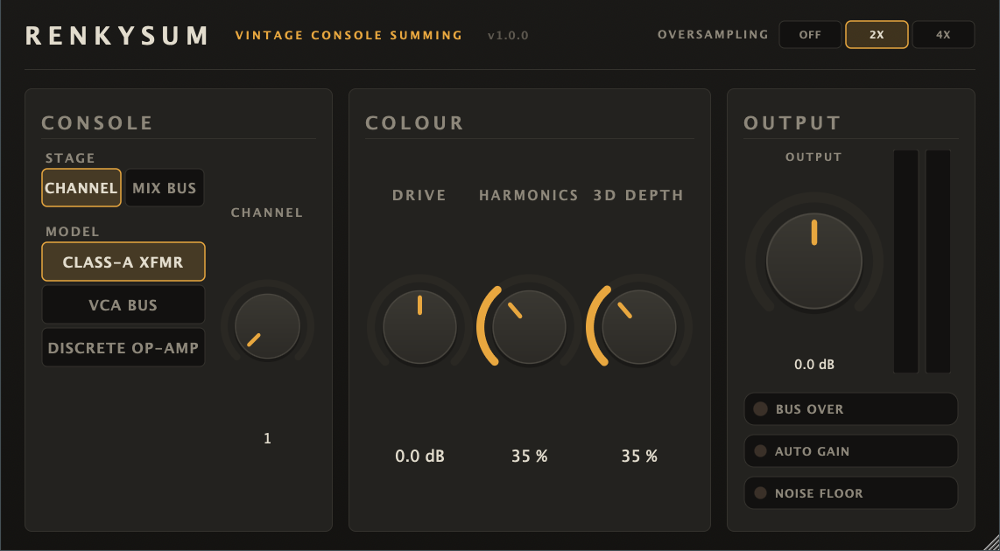

# RenkySum — Vintage Console Summing



A per-channel **vintage console summing** plug-in in the spirit of Sonimus
Satson, Waves NLS and airwindows Console. One instance goes on every track and
one on the master; together they behave like the strips and summing amp of a
real desk, with three things the usual per-track saturators leave out:

- **Per-instance component tolerances**: the **Channel** number seeds a
  deterministic spread of gain trim, HF pole, transformer asymmetry, crosstalk
  and noise, so 32 instances are 32 subtly different strips, and channel 7 is
  the same strip in every session and on every machine.
- **Complementary summing**: CHANNEL instances encode with `sin()`, the DAW
  sums, the MIX BUS instance decodes with `asin()`. One channel nulls exactly;
  several interact at the sum like a resistive summing network.
- **3D Depth**: one knob that scales the five measurable mechanisms behind the
  "dimensional" quality of analog summing (phase rotation, programme-dependent
  harmonics, rail sag, phase-blurred crosstalk, noise floor).

Three console models (CLASS-A XFMR, VCA BUS, DISCRETE OP-AMP), adjustable
harmonics, switchable 2x/4x oversampling, loudness-honest Auto Gain and a
BUS OVER lamp that tells you when the decode has left its exact region.

Formats: AU, VST3 and Standalone (macOS, Apple Silicon and Intel), VST3 and
Standalone (Windows). DSP is written in [Faust](https://faust.grame.fr) and
compiled into a JUCE 8 plug-in with a custom editor.

## Install (no build needed)

Grab the latest files from the **[Releases page](../../releases/latest)**:

* **macOS** (11 or later, Apple Silicon and Intel): download `RenkySum-<version>-macOS.pkg` and open it. If
  Gatekeeper objects (the installer is not notarized), right-click the file and choose *Open*. Tick the formats you
  want (AU, VST3, standalone app); they go to `/Library/Audio/Plug-Ins` and `/Applications`. Rescan plug-ins in
  your DAW. Prefer not to run an installer? `RenkySum-<version>-macOS-bundles.zip` has the raw bundles and a
  manual-install note.
* **Windows** (x64, when the CI build succeeds): download `RenkySum-<version>-Windows-x64.zip`, unzip, copy the
  `RenkySum.vst3` folder to `C:\Program Files\Common Files\VST3\`.

The plug-in shows up under **Renky Denk › RenkySum**. Every tagged release is built by
`.github/workflows/release.yml`; `packaging/make_installer.sh` makes the same `.pkg` locally.

## The idea

Drop one instance on every track in Ableton, set each instance to a different
**Channel** number, and the plugin behaves like 32 adjacent strips of a real
desk: nominally identical, never actually identical. Gain trims are ±0.05 dB
off, HF poles are ±12 % apart, transformer asymmetry and crosstalk differ per
strip, and the noise floors are decorrelated. The spread is deterministic —
channel 7 always sounds like channel 7, sessions recall exactly.

## Controls

| Control | What it does |
|---|---|
| **Model** | CLASS-A XFMR (transformer, 2nd-harmonic-rich, LF core saturation) / VCA BUS (clean, mostly 3rd harmonic) / DISCRETE OP-AMP (punchy odd+even blend, strongest rail sag) |
| **Stage** | CHANNEL on tracks, MIX BUS on the master. Channel instances *encode* their output with `sin()`; the bus instance *decodes* the DAW's sum with `asin()` (airwindows-Console style). One channel alone nulls perfectly, but multiple channels interact nonlinearly at the sum — the resistive-network behaviour of a real desk that plain per-track saturation can't reproduce. |
| **Channel** | 1–32. The per-instance tolerance seed. Set differently per track. |
| **Drive** | Level pushed into the summing amp (±12 dB). Use Auto Gain to keep loudness constant while adding colour. |
| **Harmonics** | Intrinsic THD of the stage at nominal level — from near-clean to well past vintage spec. |
| **3D Depth** | See below. |
| **Output / Auto Gain / Noise Floor** | Trim, drive-compensation, and switchable console hiss. |
| **Oversampling** | OFF / 2X / 4X (header). Runs the whole strip, including the saturators and the sin/asin stages, at 2 or 4 times the host rate through linear-phase half-band filters. Adds a few samples of latency, which is reported to the host. Default 2X. |
| **BUS OVER** lamp | Lights when a MIX BUS instance receives a sum above −0.9 dBFS. The `asin()` decode is only exact up to that point; beyond it the remaining headroom is compressed smoothly rather than clipped, but the summing interaction is no longer the real one. Trim the channels or the DAW faders until it stays dark. |

## What "3D Depth" actually is

The depth knob scales five mechanisms that research (null tests, airwindows
Console design notes, transformer measurements) points to as the sources of
the "dimensional" quality attributed to analog summing:

1. **Phase rotation** — transformers and coupling caps rotate phase at the
   spectrum edges. Depth moves the LF and HF all-pass corners *into* the
   audible band (LF up to ~110 Hz, HF down to ~8 kHz), dispersing transients
   the way iron and caps do.
2. **Dynamic (program-dependent) harmonics** — the even-harmonic bias
   breathes with the signal envelope, so the harmonic signature is never
   static. Static waveshaping is what most plugins do; movement is what
   analog does.
3. **Power-rail sag** — a shared (L/R common) envelope dips gain by up to
   ~0.3 dB on sustained loud material: micro-glue, front-to-back movement.
4. **Phase-blurred crosstalk** — inter-channel bleed around −52 dB whose
   path goes through the HF phase rotator, slightly decorrelating the image.
5. **Noise floor** — decorrelated hiss around −86 dBFS (switchable), which
   listeners reliably read as "air" and spatial continuity.

## Honest footnote on the research

Null and blind tests (Dan Worrall's "Summing Shmumming", Paul Frindle,
Sound on Sound) consistently show modern digital summing is transparent, and
much of the reported "depth" of hardware summing boxes traces to the extra
D/A→A/D pass and small loudness offsets (one famous SSL-vs-Neve shootout came
down to a 0.2 dB level difference). What *is* real and measurable is the
colour of driven console electronics: level-dependent harmonics, per-strip
tolerance spread, phase rotation, crosstalk and noise. This plugin models
those real mechanisms and lets you scale them from authentic (subtle) to
exaggerated — and Auto Gain keeps A/B comparisons loudness-honest.

## Measured behaviour (48 kHz, 1 kHz sine)

These figures come from `tests/measure.cpp`, which drives the generated DSP
directly and fails the build's test step if they drift (`ctest --test-dir build`).

- Default settings, −12 dBFS: THD 0.55 % (H2 −54 dB, H3 −46 dB) — "driven
  vintage" territory. Harmonics = 0 measures ≈ −150 dB H2 (only the
  channel-stage `sin()` encode's own H3 remains, which the bus removes).
- Encode→decode null at −3 dBFS: channel-stage `sin()` adds −33 dB H3, which
  the bus-stage `asin()` cancels to −74 dB. Interaction survives only *between*
  channels.
- Channel 1 vs channel 2 (same audio): −42 dB decorrelation. Channel 1 vs
  channel 1: bit-identical. Strip gain spread across all 32 channels: 0.10 dB.
- Noise floor at full Depth: −92 dBFS RMS. Correlation L/R and between
  channel 1 and channel 2 is below 0.01, so 32 instances of hiss sum as noise,
  not as one louder noise.
- MIX BUS fed +2.9 dBFS: output stays bounded (+2.1 dBFS peak, no clipping
  artefacts). Channel stage output never exceeds 0 dBFS.

## Workflow in Ableton

1. AU: **RenkySum** on every track — Stage = CHANNEL, a different Channel
   number per track, Drive/Harmonics to taste.
2. One instance on the Master — Stage = **MIX BUS** (this decodes the sum;
   without it the sin() encode acts as a mild extra saturator, which is fine
   but skips the interaction trick).
3. A/B with Auto Gain on so loudness bias doesn't fool you.

## Build from source

The DSP lives in `dsp/RenkySum.dsp`; `Source/dsp/RenkySumDSP.h` is the committed
Faust output, so a plain CMake + JUCE build needs no Faust (JUCE 8.0.6 is used
from `~/JUCE` if present, otherwise fetched):

```sh
cmake -B build -DCMAKE_BUILD_TYPE=Release        # add -DRENKYSUM_ARCHS=arm64 for a faster native-only macOS build
cmake --build build -j
ctest --test-dir build                            # DSP measurements (tests/measure.cpp)
# bundles land in build/RenkySum_artefacts/Release/{AU,VST3,Standalone}
packaging/make_installer.sh build                 # optional: dist/RenkySum-<version>-macOS.pkg + bundles zip
```

Add `-DRENKYSUM_COPY_PLUGIN=ON` to have each build copied into
`~/Library/Audio/Plug-Ins` automatically.

To change the DSP, edit `dsp/RenkySum.dsp` and regenerate the header
(requires [Faust](https://faust.grame.fr), `brew install faust`):

```sh
scripts/regen_dsp.sh            # or: cmake --build build --target regen_dsp
```

For instant browser prototyping, paste `dsp/RenkySum.dsp` into the
[Faust Web IDE](https://faustide.grame.fr).

## Repository layout

| Path | Role |
|---|---|
| `dsp/RenkySum.dsp` | All signal processing. Controls are grouped `Console / Colour / Output`. |
| `Source/dsp/RenkySumDSP.h` | Generated from the above. Never edit by hand. |
| `Source/dsp/FaustDsp.h`, `FaustZoneMap.h` | Tiny Faust runtime interfaces and a path → control-zone map, so the build does not depend on Faust's headers. |
| `Source/Parameters.{h,cpp}` | **The parameter table.** One row per control: host id, Faust path, range, display format. Drives the APVTS layout, the DSP binding and the editor's formatting. |
| `Source/dsp/ConsoleEngine.{h,cpp}` | Owns the DSP, pushes parameters into it, runs it in chunks, publishes meter/over data. The place to add oversampling, lookahead, A/B, etc. |
| `Source/PluginProcessor.{h,cpp}` | JUCE processor: buses, state (versioned), mono handling. |
| `Source/PluginEditor.{h,cpp}`, `Source/ui/` | Custom editor: theme, look-and-feel, knobs, segment selectors, LED toggles, stereo meter with BUS OVER lamp. Resizable, fixed aspect. |
| `tests/measure.cpp` | Measurement harness and regression checks over the generated DSP. |
| `assets/` | App icon and installer artwork (SVG sources plus the PNGs the build uses). |

### Adding a control

1. Add the widget to `dsp/RenkySum.dsp` (inside one of the existing groups,
   or a new `h:` group) and run `scripts/regen_dsp.sh`.
2. Add one row to `rs::specs()` in `Source/Parameters.cpp` with the matching
   Faust path (`/RenkySum/<Group>/<Label>`).
3. Add a widget in `PluginEditor` and place it in `resized()`.

The engine asserts in debug builds if a table row's path no longer exists in
the DSP, so renames are caught at first run. A row with a null Faust path is
an engine-side parameter (oversampling is one); read it in `ConsoleEngine`.

## Tests

```sh
cmake --build build --target renkysum_measure && ctest --test-dir build --output-on-failure
```

`tests/measure.cpp` drives the generated DSP class directly (no JUCE, no audio
device) and checks 15 figures: THD and harmonic balance at the default
setting, the clean-setting residual, the encode/decode null, channel-to-channel
decorrelation and bit-exact recall, strip gain spread across all 32 channels,
noise-floor level and decorrelation (L/R and between channels), bounded output
on an over-range bus input, and sample-rate independence of the harmonic
signature (which oversampling relies on). `auval` passes for the AU.

## Licensing

The project's own code and DSP are MIT (see `LICENSE`). Binaries also contain
JUCE, which is dual-licensed; distributing builds without a JUCE licence falls
under JUCE's AGPLv3 terms. The splash screen is disabled on that basis.
